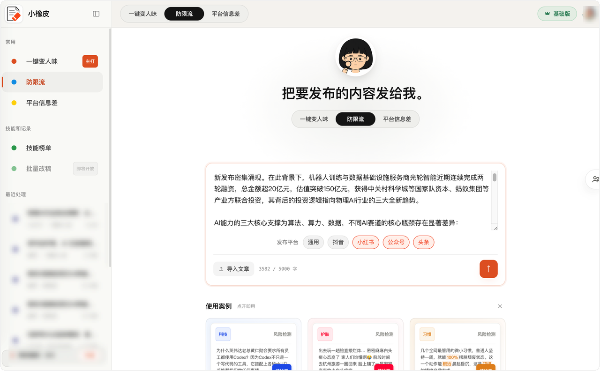

# AI稿子没有流量？一套流程去除 AI 写作痕！减少账号限流

做运营的朋友大多都遇到过难题，**怎么消除 ai 写作痕迹**、靠谱的**去除 ai 写作痕迹**的方法到底是什么。不少人到处找**去 ai 味网站**，照搬网上的**去除 ai 痕迹指令**，反复尝试各类**免费去除 ai 痕迹工具**，改完之后稿件依旧** AI 味**很重，**AI 痕迹**一眼就能被识别出来。今天结合自己实际踩坑经历，聊聊问题根源，分享一套高效**去 AI 痕迹**的实操办法。

## 一、为什么你的 AI 稿件发出去没有流量

现在做自媒体，几乎大家都会借助 AI 快速产出初稿，但真正能拿到不错数据的内容并不多。很多人第一反应会怀疑选题不行、封面配图不够吸引人，实际上很多时候问题并不在这，根源就是**AI 写作痕迹太重**。

很多人的改稿方式其实都是无效劳动：单纯替换同义词、调换语序、加长提示词、手动删除多余废话。这么折腾一番，AI 底层的写作框架完全没有改变，机器味依旧藏在文本里面，改多少遍还是摆脱不了机器稿的属性。

对比看过大量 **AI 生成文稿**之后我发现，**AI 味**主要来自两部分：一是整篇文章的底层框架结构，二是句子层面的行文表达习惯，只修改表面文字很难从根源解决。

## 二、文章框架里面的 AI 痕迹

**AI 写内容**，很喜欢套用规整的总分总模板。 开头先抛出总观点，分段一层一层展开，结尾再来总结升华。就连每一个小标题下面，也习惯严格套用 “是什么、为什么、怎么做” 这套固定逻辑。 读者稍微读几段，就能预判后面要讲什么，阅读体验缺少惊喜感。

如果是新手运营，自己手动重构整篇文章框架，难度不小，很容易把原本通顺的内容改得逻辑断裂。这种情况，用专业工具辅助处理会轻松很多，不用一个人硬扛结构改写。

## 三、句式表达里的 AI 痕迹

框架相对隐蔽，句式层面的** AI 特征**会更加明显，也是大多数人改稿的重点。 第一种很常见，就是 “不是 A，而是 B” 的句式。AI 经常先虚构一个错误观点，否定之后，再抛出自己想表达的内容。 第二种是扎堆出现的三连式形容词，像 “最实用、最直接、最高效” 这类排比修饰，在 **AI 文稿**里随处可见。 还有一种写法，习惯先搭建很长的前置句式，再用冒号引出简单概念，一句话绕来绕去，读起来不够干脆自然。

做多平台分发的时候也要留意，同一篇文案原封不动分发到多个渠道，文风完全一样，会加重平台判定的同质化问题。

我自己日常改稿会用**小橡皮 AI**，它支持根据不同平台调整文风，网页端直接打开就能用。

传送门：[小橡皮](https://xiangpiai.cn/workspace?from=github0901jw)[https://xiangpiai\.cn/](https://xiangpiai.cn/workspace?from=github0901jw)

改写的时候，它会自动打散过于工整的长句，清理模板化套话，重新调整长短句节奏，改成更像真人写出来的感觉。改写完成后，页面会逐条展示所有修改位置，标注清楚每一处改动的原因，方便我们核对。

还有一个很容易忽略的问题：有些运营明明把 AI 痕迹处理好了，发布之后依旧限流、账号权重下滑。

根源并不是 **AI 味**，而是文章里面藏着极限词、营销话术、各类平台敏感词。**小橡皮 AI** 自带多平台风控筛查，覆盖小红书、抖音、视频号、公众号、知乎，提前排查这些隐形风险。对新手运营很友好，可以一次性解决去 AI 痕迹和发文合规两个痛点。

## 四、我日常批量出稿的标准化 SOP

分享一套我日常批量产出内容的稳定流程，写稿的时候直接套用：

1. 使用 **AI 生成初稿**，不用纠结细节，也不用反复打磨提示词，先把核心观点和素材搭好；

2. 文稿粘贴导入**小橡皮 AI**，选择对应的发布平台，一键重构真人语感，深度消除 ai 痕迹；

3. 查看可视化修改记录，手动微调，保留属于你自己的写作风格；

4. 运行风控扫描，修改所有标记出来的敏感词、极限话术；

5. 通读全文调整语感，确认没问题再发布。

## 五、写在最后

现在做内容创作，完全不用 AI 很难跟上持续更新的节奏，但只会生成不会优化稿件，很难拿到平台推荐。不用到处搜集各类**消除 ai 痕迹**网站，反复测试**免费去除 ai 痕迹**工具，死磕网上效果参差不齐的提示词。

工具只是辅助，真正的内核还是你的内容想法。借助**降ai工具**清理机器痕迹、排查发文风险，再简单人工通读调整，做内容会省心很多。

